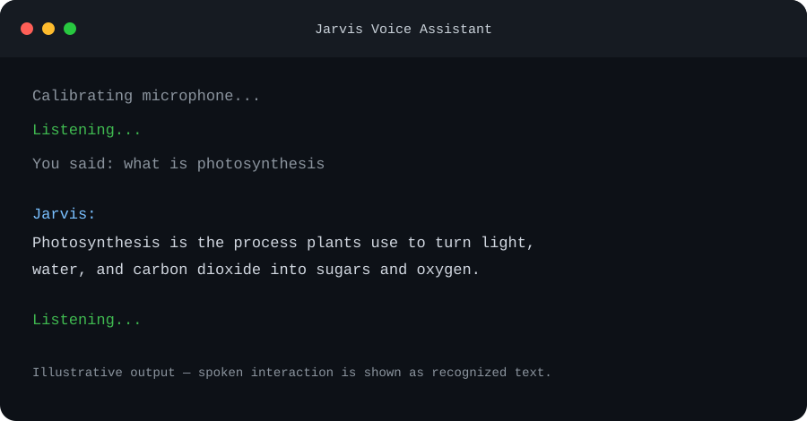

# Jarvis Voice Assistant

A small Windows voice assistant built with Python. Jarvis listens for spoken commands, speaks responses aloud, opens websites and selected desktop apps, plays music links, reads news headlines, and answers general questions using a local Ollama model.

## Terminal preview

Illustrative example of Jarvis listening and answering a spoken question. The response is sample text; actual answers come from your local Ollama model.



## Features

- Voice input through SpeechRecognition and a microphone
- Spoken output through Windows built-in text-to-speech
- Opens common websites, arbitrary domains, and web searches
- Opens Calculator, Notepad, Paint, File Explorer, Microsoft Word, and Excel
- Plays songs listed in `musiclibrary.py`
- Optional NewsAPI headlines with summaries
- Local AI answers through Ollama; no OpenAI key is needed

## Requirements

- Windows 10 or newer
- Python 3.13 (the project virtual environment is named `.venv-py313`)
- A microphone and speakers/headphones
- Internet access for speech recognition, news, and websites
- Ollama and the `qwen2.5:3b` model for general AI answers

## Setup

Open PowerShell in the project folder and create the virtual environment:

```powershell
py -3.13 -m venv .venv-py313
.\.venv-py313\Scripts\python.exe -m pip install --upgrade pip
.\.venv-py313\Scripts\python.exe -m pip install -r requirements.txt
```

Install Ollama from [ollama.com](https://ollama.com), then download the model:

```powershell
ollama pull qwen2.5:3b
```

Ollama must be running when Jarvis handles general questions. Verify it with:

```powershell
ollama run qwen2.5:3b
```

Type `/bye` to leave the model prompt.

## Optional news setup

News commands need a NewsAPI key. Copy `.env.example` to `.env` and put your key after `NEWS_API_KEY=`. The `.env` file is ignored by Git and must never be committed.

## Run Jarvis

Double-click `run_jarvis.bat`, or from PowerShell run:

```powershell
.\.venv-py313\Scripts\python.exe main.py
```

Wait for **Listening...**, then try:

- “Open Google”, “Open ChatGPT”, or “Open example.com”
- “Open Calculator”, “Open Word”, or “Open Excel”
- “Play Baby”, “Play Sorry”, or “Play Unstoppable”
- “Tell me the news”
- “What is photosynthesis?”

Say `Ctrl+C` in the terminal to stop Jarvis.

## Privacy and API notes

- Speech recognition uses Google’s online recognition service; audio is sent to that service for transcription.
- General AI prompts are sent to the local Ollama service running on this computer.
- NewsAPI is contacted only when a news command is used.
- Website commands open a browser and may send the destination/search query to that website.
- Never commit `.env` or publish API keys. Revoke any key that has been shared publicly.
- Arbitrary shell commands are intentionally not supported. Desktop app launches are limited to the explicit allowlist in `main.py`.

## Troubleshooting

- **Microphone errors:** check Windows microphone permissions and the selected input device. The default headset index is configured near the top of `main.py`.
- **Ollama errors:** start Ollama and confirm `qwen2.5:3b` is installed with `ollama list`.
- **News errors:** verify `NEWS_API_KEY` in `.env`; news requires internet access and a working NewsAPI account.
- **No spoken audio:** check Windows output device and volume. Jarvis uses Windows PowerShell's `System.Speech` voice.
- **Module not found:** run Jarvis through the project virtual environment command above.

## Tests

Run the local command-routing tests with:

```powershell
.\.venv-py313\Scripts\python.exe -m unittest
```
